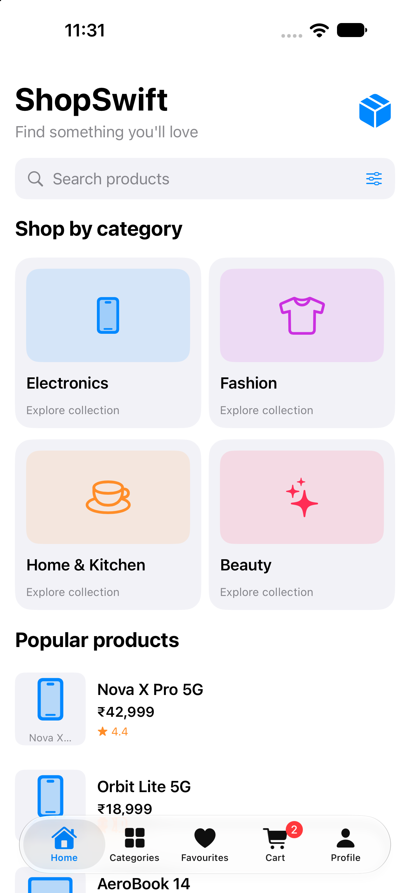
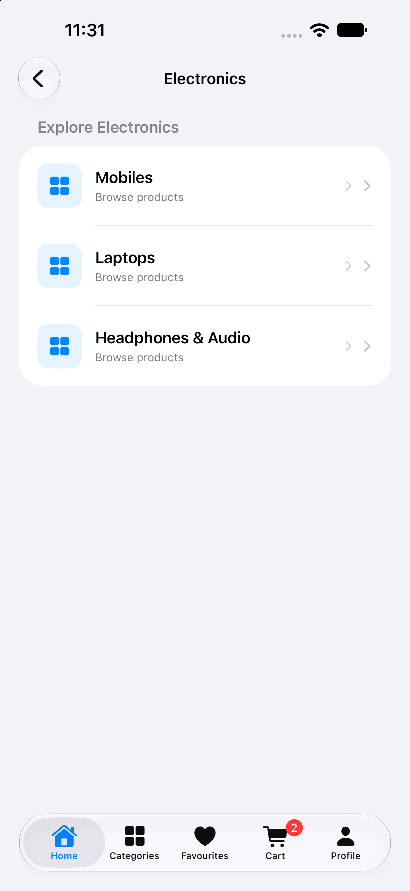
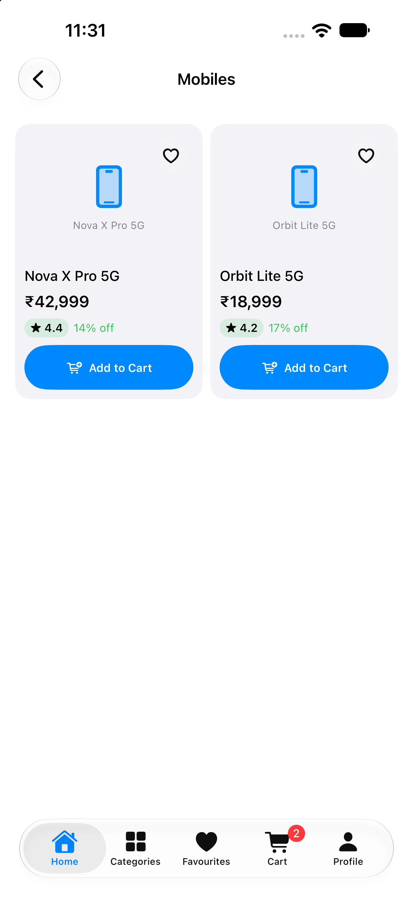
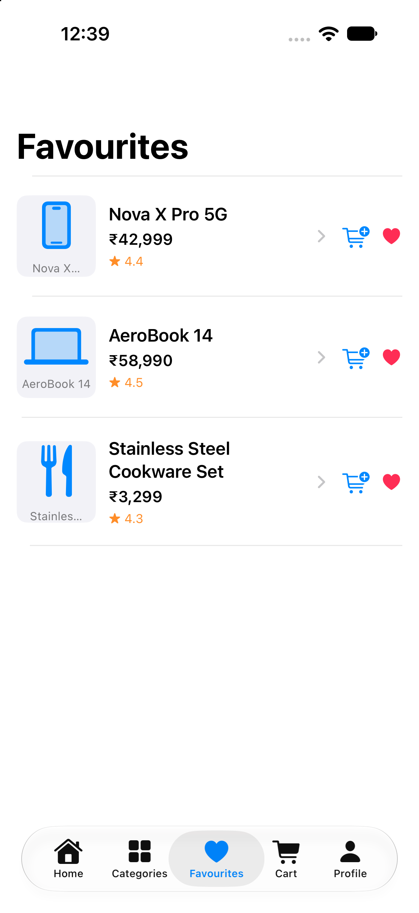
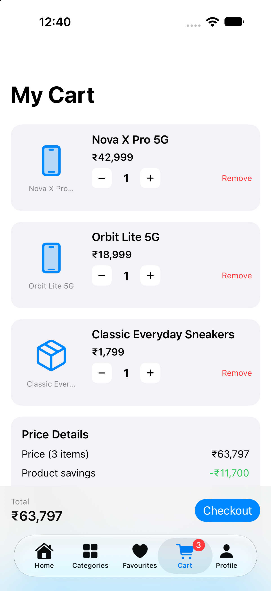

🛍️ ShopSwift – iOS Shopping Application

ShopSwift is a modern e-commerce shopping application built using Swift and SwiftUI. It provides a seamless shopping experience with product browsing, category navigation, favourites management, shopping cart functionality, and a checkout flow.

The application follows an MVVM-style architecture with reusable SwiftUI components, local data persistence, and an API-ready service layer.

🚀 Features

🏠 Product Browsing

Browse products by categories and subcategories.

View product listings with images, names, and prices.

Navigate to detailed product information.

Clean and responsive SwiftUI interface.

📸 App Screenshots

🏠 Home Screen

📂 Categories

🛍️ Product Details

❤️ Favourites

🛒 Shopping Cart

❤️ Favourites

Add and remove products from favourites.

Maintain a shared favourites collection.

Persist favourite selections locally.

🛒 Shopping Cart

Add products to the shopping cart.

Increase or decrease product quantities.

Remove products from the cart.

Automatically calculate item totals.

Display the cart subtotal and price summary.

💳 Checkout

Review selected products before checkout.

View the total order amount.

Demo checkout flow.

⚙️ Architecture & Design

MVVM-style architecture.

SwiftUI declarative UI.

ObservableObject and @Published for reactive state management.

Reusable UI components.

Centralized shopping cart and favourites management.

Local persistence.

API-ready networking architecture.

🛠️ Tech Stack

Technology

Purpose

Swift

Programming Language

SwiftUI

User Interface

MVVM

Application Architecture

Combine

Reactive State Management

URLSession

API Networking

Codable

JSON Encoding & Decoding

UserDefaults

Local Data Persistence

Xcode

Development Environment

📂 Project Architecture

ShopSwift/
│
├── App/
│   └── ShopSwiftApp.swift
│
├── Models/
│   ├── Product.swift
│   ├── Category.swift
│   └── CartItem.swift
│
├── Views/
│   ├── HomeView.swift
│   ├── CategoryView.swift
│   ├── ProductListView.swift
│   ├── ProductDetailView.swift
│   ├── FavoritesView.swift
│   ├── CartView.swift
│   └── CheckoutView.swift
│
├── ViewModels/
│   └── ShoppingStore.swift
│
├── Services/
│   ├── ShoppingAPI.swift
│   └── APIService.swift
│
├── Resources/
│
└── README.md

Note: The structure above illustrates the logical project organization; adjust filenames to match the actual repository.

⚙️ Getting Started

Prerequisites

macOS

Xcode

Swift with SwiftUI support

iOS Simulator or a physical iPhone

